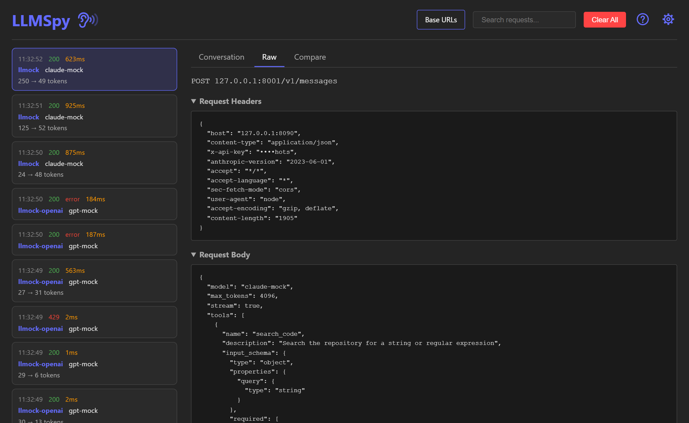
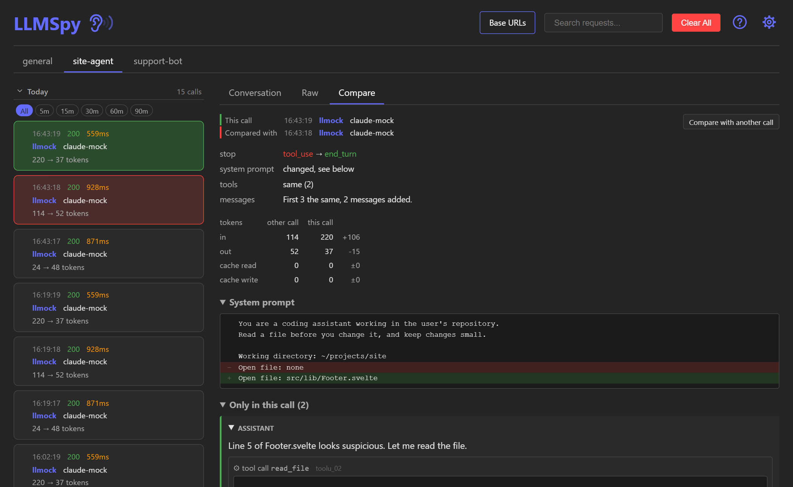
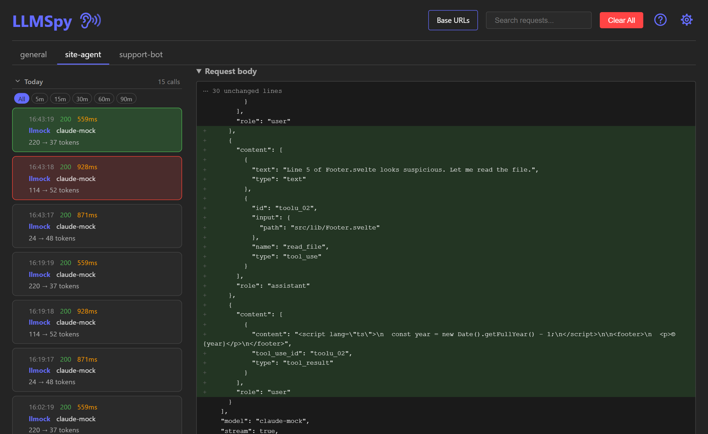

# LLMSpy

A local developer tool that shows LLM API traffic in real time.


## Why

Apps and agents built on LLMs hide most of what they send. SDKs, frameworks and coding agents add their own system prompts, tool definitions, retries and parameters, and the actual request and response are rarely logged anywhere you can read them. When an agent misbehaves, burns tokens, or gives a strange answer, the first question is "what did it actually send to the model, and what came back?", and that is usually the hardest one to answer.

LLMSpy answers it without changing any code. It runs on your machine as a small reverse proxy: point an app's base URL at it (most LLM SDKs and tools read one from an environment variable, such as `ANTHROPIC_BASE_URL` or `OPENAI_BASE_URL`), and every call shows up live in a web UI with the full headers, prompt, parameters, response, status and timing. Streamed responses still stream to the app; LLMSpy keeps a copy as they pass.

Use it to:

- see the real prompts, system messages and tool schemas a library or agent sends
- debug failing or odd requests: errors, status codes, latency
- understand token-heavy calls and why they cost what they do
- compare what different tools send for the same task

It is for local development only. It listens on `127.0.0.1`, masks API keys in what it records, and keeps the last 500 requests in memory only.

## What you see

Every call appears in the list on the left as it happens, newest first, with its status, time taken and token counts. Select one to look at it three ways.

**Conversation** (above) reads the call as the model sees it: the system prompt and tools, then each message by role, with tool calls matched to their results, and the reply at the end with its stop reason and token use. Streamed replies are put back together. LLMSpy reads the Anthropic Messages, OpenAI Chat Completions and OpenAI Responses formats.

**Raw** shows the request and response exactly as they went over the wire: method and URL, headers (with API keys masked) and both bodies.



**Compare** sets the selected call (green) against another (red): by default the previous call to the same upstream, which in an agent loop is the turn before; "Compare with another call" picks any other. It sums up what changed (model, stop reason, system prompt, tools, messages and tokens) and shows only the messages that are new.



Under the summary, a line diff of the two request bodies shows everything else that changed, such as `max_tokens`, `temperature` or a tool's schema, with unchanged stretches folded away.



The traffic in these screenshots is made up, sent to the mock server described under [Testing without an API key](#testing-without-an-api-key).

## Quick start

With Docker:

```bash
npm run start:docker   # docker compose up -d --build
```

LLMSpy then runs in the background, restarts with Docker, and serves the proxy and the UI on `http://127.0.0.1:8080`. The port is published on the loopback interface only, so nothing outside your machine can reach it. Captured traffic (`/api/*`, `/events`, `/ping`) is only served to requests addressed to `localhost`, `127.0.0.1` or `[::1]`, and not to other web sites open in your browser. `npm run stop:docker` (`docker compose down`) stops it; captured requests are kept in memory and go with it.

Then point an app at the proxy by the provider's path prefix:

| Prefix       | Forwards to                 | Example                                              |
| ------------ | --------------------------- | ---------------------------------------------------- |
| `/anthropic` | `https://api.anthropic.com` | `ANTHROPIC_BASE_URL=http://127.0.0.1:8080/anthropic` |
| `/openai`    | `https://api.openai.com`    | `OPENAI_BASE_URL=http://127.0.0.1:8080/openai/v1`    |

For example, in PowerShell:

```powershell
$env:ANTHROPIC_BASE_URL = "http://127.0.0.1:8080/anthropic"
claude
```

Each request then appears in the UI at `http://127.0.0.1:8080`.

For coding agents and scripts, [llms.txt](llms.txt) is a compact reference: how to run LLMSpy, point an app at it, and read the captured traffic as JSON.

## Configuration

| Variable           | Default     | Meaning                                                       |
| ------------------ | ----------- | ------------------------------------------------------------- |
| `PROXY_PORT`       | `8080`      | Port for the proxy and the UI                                 |
| `LLMSPY_HOST`      | `127.0.0.1` | Interface to listen on; the Docker image sets `0.0.0.0`       |
| `LLMSPY_UPSTREAMS` |             | Extra or replacement upstreams, as comma-separated `name=url` |

`LLMSPY_UPSTREAMS` adds a prefix per entry, and a name that matches a default replaces it. A path in the URL is kept, and the rest of the request path is appended to it:

```bash
LLMSPY_UPSTREAMS=ollama=http://localhost:11434,gemini=https://generativelanguage.googleapis.com
# http://127.0.0.1:8080/ollama/api/chat -> http://localhost:11434/api/chat
```

Names are lowercase letters, digits and dashes; `api`, `assets`, `events` and `ping` are taken by LLMSpy itself.

With Docker, set `LLMSPY_UPSTREAMS` in the shell or in a `.env` file next to `compose.yaml` before `docker compose up`. Inside the container `localhost` is the container itself, so an upstream running on your machine is `host.docker.internal`:

```bash
LLMSPY_UPSTREAMS=ollama=http://host.docker.internal:11434 docker compose up -d
```

## How it works

- `proxy/`: one Node HTTP server. `/<prefix>/...` is forwarded to the upstream with the bytes unchanged, chunk by chunk, while a copy of each body is kept, decompressed (gzip, deflate, br, zstd) and decoded for display. `/events` (Server-Sent Events), `/api/requests`, `/api/upstreams` (each prefix and where it forwards to) and `/api/clear` serve the UI, and any other path is a file from the built UI (`ui/dist`).
- `ui/`: Svelte and Vite.

## Development

```bash
npm install
npm run dev
```

This starts the proxy on `http://127.0.0.1:8080` and the web UI, with live reload, on `http://localhost:3000`. Stop the Docker container first, as both use port 8080. `npm run build` then `npm start` runs the built proxy, which serves the built UI itself at `http://127.0.0.1:8080/`. `npm run stop`, from any terminal, stops it: on startup the proxy writes its pid to `~/.llmspy/llmspy.pid`.

| Command                | What it does                                   |
| ---------------------- | ---------------------------------------------- |
| `npm run dev`          | Proxy and UI with reload                       |
| `npm run build`        | Build both packages                            |
| `npm start`            | Run the built proxy                            |
| `npm run stop`         | Stop the proxy started with `npm start`        |
| `npm run start:docker` | Build and start the Docker container           |
| `npm run stop:docker`  | Stop and remove the Docker container           |
| `npm test`             | Run the tests                                  |
| `npm run lint`         | Biome lint and format check                    |
| `npm run typecheck`    | `tsc` for the proxy, `svelte-check` for the UI |
| `npm run mock`         | Mock LLM APIs for testing (below)              |

### Testing without an API key

`npm run mock` starts two [llmock](https://www.npmjs.com/package/llmock) servers, with their config in `mock/.llmockrc.json`: the Anthropic Messages API on `http://127.0.0.1:8001` and OpenAI Chat Completions on `http://127.0.0.1:8002`. They reply with generated text, so no key or network is needed. Point LLMSpy at them, then send traffic:

```bash
LLMSPY_UPSTREAMS=llmock=http://127.0.0.1:8001,llmock-openai=http://127.0.0.1:8002 npm run dev
node scripts/mock-traffic.mjs
```

The script sends one request of each kind below. To use the mocks from your own client, set its base URL to `http://127.0.0.1:8080/llmock` (Anthropic) or `http://127.0.0.1:8080/llmock-openai/v1` (OpenAI), with any non-empty key. A marker in the last message picks the reply:

| Marker          | Reply                                                       |
| --------------- | ----------------------------------------------------------- |
| `#tools`        | A `get_weather` tool call (Anthropic); a tool result containing `sunny` gets the final answer |
| `#max-tokens`   | A reply cut off at the token limit                           |
| `#refusal`      | A refusal                                                    |
| `#rate-limit`   | HTTP 429                                                     |
| `#stream-error` | A stream that sends an error event part-way through          |
| `#stream-drop`  | A stream whose connection is cut part-way through            |

Anything else gets random lorem ipsum. Both mocks stream when the request sets `"stream": true`.

## Troubleshooting

- **The app still calls the provider directly.** Check that it reads the base URL variable you set, and that it was started after you set it.
- **404 from LLMSpy.** The path prefix doesn't match an upstream; the response lists the known ones.
- **502 from LLMSpy.** The upstream could not be reached; the request in the UI shows the error.

## License

MIT, see [LICENSE](LICENSE).
