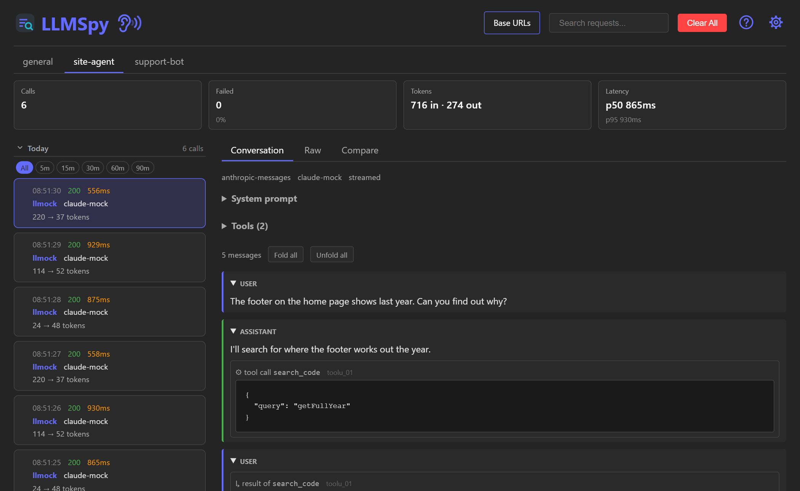

# LLMSpy

[](https://github.com/piyook/llmspy/releases)
[](https://www.npmjs.com/package/llmspy)
[](https://github.com/piyook/llmspy/actions/workflows/checks.yaml)
[](LICENSE)
[](https://nodejs.org/)
[](https://www.typescriptlang.org/)

A lightweight local developer tool that shows LLM API traffic in real time, with next to no setup: to you in a web UI, and to coding agents through a small local API.

**📖 Documentation: [llmspy.piyook.com](https://llmspy.piyook.com/)**



## Why LLMSpy?

SDKs, frameworks and coding agents add their own system prompts, tool definitions, retries and parameters, and the actual request and response are rarely logged anywhere you can read them. LLMSpy shows you what an app really sent to the model and what came back, without changing any code.

- **Live capture**: every call to Anthropic, OpenAI or [any other upstream](https://llmspy.piyook.com/guide/upstreams) shows up as soon as it is sent; streamed replies still stream to the app
- **Conversation view**: system prompt, tools, messages, tool calls matched to their results, and the reply with its stop reason and token use ([more](https://llmspy.piyook.com/guide/reading-a-call))
- **Raw view**: headers and bodies exactly as sent and received, with API keys masked
- **Compare**: [diff a call](https://llmspy.piyook.com/guide/compare) against the one before it to see what an agent changed between turns
- **Projects**: [tag each app's base URL](https://llmspy.piyook.com/guide/projects) to give its calls their own tab
- **Three formats**: Anthropic Messages, OpenAI Chat Completions and OpenAI Responses, streamed or not
- **Kept across restarts**: the last 7 days of calls, in one file on your machine, with chips for recent minutes and failed calls ([more](https://llmspy.piyook.com/guide/call-list))
- **Agent friendly**: coding agents and scripts [list, search and read the calls](https://llmspy.piyook.com/guide/agents) as JSON or Markdown, and wait for a running call to end
- **Lightweight**: one command to start, one base URL to set; no certificates, accounts or runtime dependencies

## Quick start

With **Node.js 26 or later**, from any folder:

```bash
npx llmspy
```

This serves the proxy and the UI on `http://127.0.0.1:8080`. Stop it with Ctrl+C, or `npx llmspy stop` from any terminal; `npx llmspy -b` runs it in the background. To run it in Docker or from source, see [Installation](https://llmspy.piyook.com/guide/installation).

## Point an app at it

Set the app's base URL to LLMSpy plus the provider's path prefix:

| Prefix       | Forwards to                 | Example                                              |
| ------------ | --------------------------- | ---------------------------------------------------- |
| `/anthropic` | `https://api.anthropic.com` | `ANTHROPIC_BASE_URL=http://127.0.0.1:8080/anthropic` |
| `/openai`    | `https://api.openai.com`    | `OPENAI_BASE_URL=http://127.0.0.1:8080/openai/v1`    |

For example, to watch Claude Code:

```bash
ANTHROPIC_BASE_URL=http://127.0.0.1:8080/anthropic claude
```

Each call then appears in the UI at `http://127.0.0.1:8080`. The app keeps its own API key, which LLMSpy passes on to the provider. To add OpenRouter, Gemini, Ollama or a gateway, see [Upstreams](https://llmspy.piyook.com/guide/upstreams).

## Documentation

| | |
|---|---|
| **Start here** | [Getting started](https://llmspy.piyook.com/guide/getting-started) · [Installation](https://llmspy.piyook.com/guide/installation) |
| **Using the UI** | [The call list](https://llmspy.piyook.com/guide/call-list) · [Reading a call](https://llmspy.piyook.com/guide/reading-a-call) · [Comparing calls](https://llmspy.piyook.com/guide/compare) · [Projects](https://llmspy.piyook.com/guide/projects) |
| **Connect your apps** | [Upstreams](https://llmspy.piyook.com/guide/upstreams) · [Docker](https://llmspy.piyook.com/guide/docker) · [Apps without a base URL](https://llmspy.piyook.com/guide/without-base-url) |
| **Agents and scripts** | [Reading calls from code](https://llmspy.piyook.com/guide/agents) |
| **Reference** | [CLI](https://llmspy.piyook.com/reference/cli) · [Configuration](https://llmspy.piyook.com/reference/configuration) · [HTTP API](https://llmspy.piyook.com/reference/api) · [How it works](https://llmspy.piyook.com/reference/how-it-works) |
| **Help** | [Troubleshooting](https://llmspy.piyook.com/troubleshooting) · [Testing with mock data](https://llmspy.piyook.com/guide/mock-data) · [Releases](https://github.com/piyook/llmspy/releases) |

> **Using a coding agent?** Point it at [`llms.txt`](llms.txt) (shipped in the npm package, and served by a running LLMSpy at `http://127.0.0.1:8080/llms.txt`): how to run LLMSpy, point an app at it, and read the captured traffic.

> **Note:** LLMSpy is for local development only. It listens on `127.0.0.1`, masks API keys in what it records, and keeps the last 7 days of calls in a file on your machine. See [Storage](https://llmspy.piyook.com/reference/configuration#storage).

## License

MIT, see [LICENSE](LICENSE).
