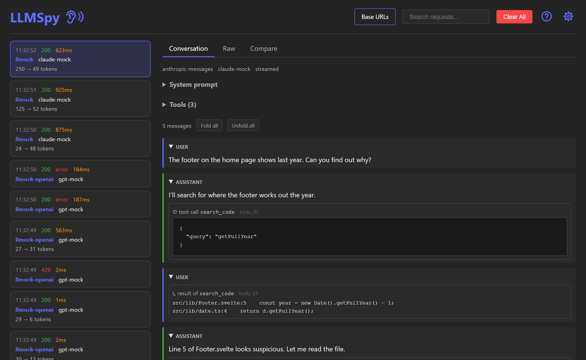
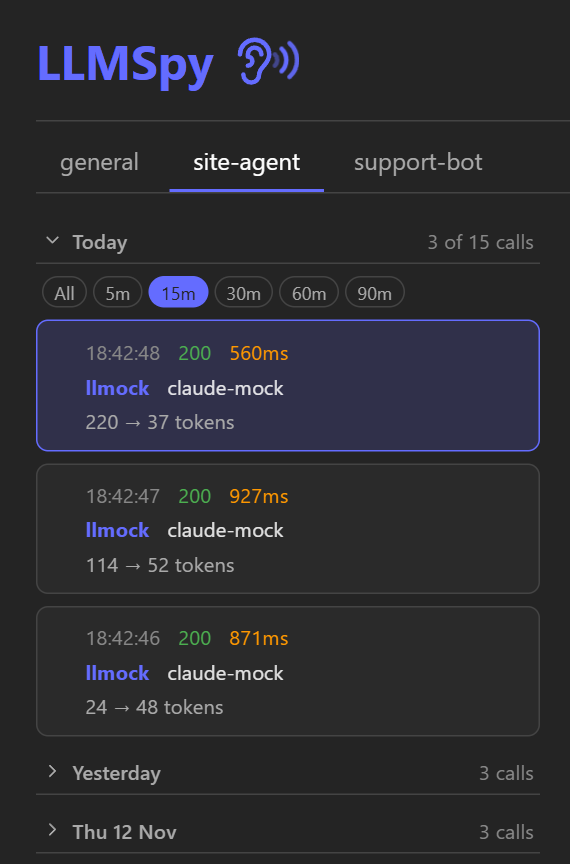
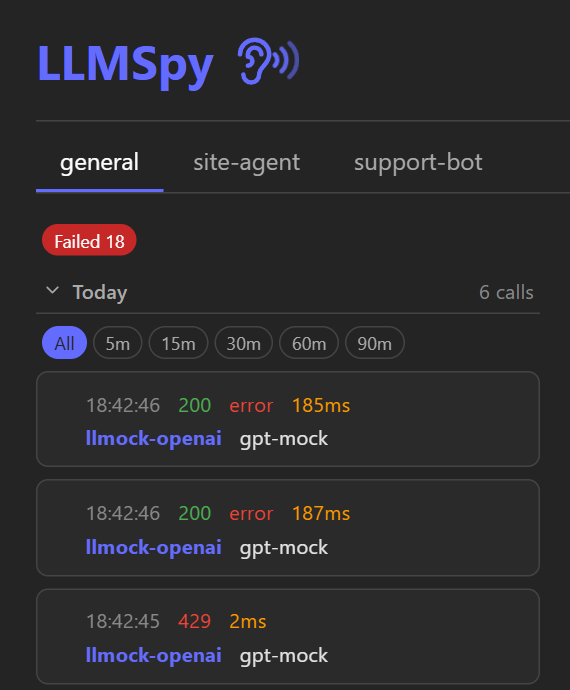
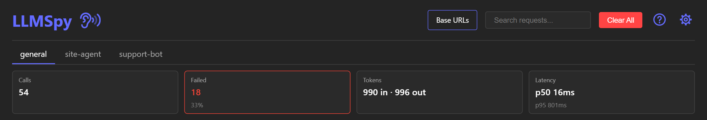
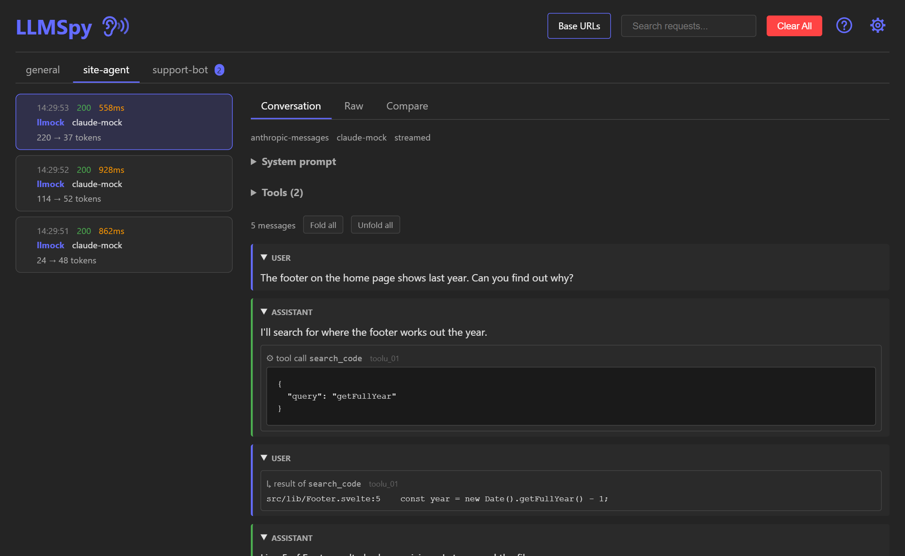

# LLMSpy

[](https://github.com/piyook/llmspy/releases)
[](https://www.npmjs.com/package/llmspy)
[](https://github.com/piyook/llmspy/actions/workflows/checks.yaml)
[](LICENSE)
[](https://nodejs.org/)
[](https://www.typescriptlang.org/)

A lightweight local developer tool that shows LLM API traffic in real time, with next to no setup: to you in a web UI, and to coding agents through a small local API.

- **Live capture**: every call to Anthropic, OpenAI or any other upstream you add shows up as soon as it is sent and is filled in when the reply ends; streamed replies still stream to the app
- **Conversation view**: system prompt, tools, messages, tool calls matched to their results, and the reply with its stop reason and token use
- **Raw view**: headers and bodies exactly as sent and received, with API keys masked
- **Compare**: diff a call against the one before it, or any other, to see what an agent changed between turns
- **Projects**: tag each app's base URL to give its calls their own tab
- **Three formats**: Anthropic Messages, OpenAI Chat Completions and OpenAI Responses, streamed or not
- **Kept across restarts**: the last 7 days of calls, in one file on your machine, listed by day with older days folded away; one click narrows today's calls to the last 5 to 90 minutes, another to the failed ones
- **Agent friendly**: coding agents and scripts can list, search and read the captured calls as JSON, or one call as Markdown, count their tokens, failures and latency, and wait for a running call to end, all on the same port; [llms.txt](llms.txt) tells them how
- **Lightweight**: one command to start, one base URL to set in your app; no certificates or accounts
- **No runtime dependencies**: the npm package installs nothing else; the proxy uses only Node.js's own modules, and the UI's two libraries (Svelte and jsdiff) are built into its files



## Contents

- [Why](#why)
- [What you see](#what-you-see)
- [Quick start](#quick-start)
  - [Start LLMSpy](#start-llmspy)
  - [Point an app at it](#point-an-app-at-it)
  - [Keep apps apart with projects](#keep-apps-apart-with-projects)
- [Commands](#commands)
- [Upstreams](#upstreams)
  - [Adding an upstream](#adding-an-upstream)
  - [Setting upstreams for a local run](#setting-upstreams-for-a-local-run)
  - [Setting upstreams in Docker](#setting-upstreams-in-docker)
  - [Checking your upstreams](#checking-your-upstreams)
  - [Apps without a base-URL setting](#apps-without-a-base-url-setting)
- [Configuration](#configuration)
  - [Storage](#storage)
- [Testing with mock data](#testing-with-mock-data)
- [How it works](#how-it-works)
- [Troubleshooting](#troubleshooting)
- [License](#license)

## Why

Apps and agents built on LLMs hide most of what they send. SDKs, frameworks and coding agents add their own system prompts, tool definitions, retries and parameters, and the actual request and response are rarely logged anywhere you can read them. When an agent misbehaves, burns tokens or gives a strange answer, the first question is "what did it actually send to the model, and what came back?", and that is usually the hardest one to answer.

LLMSpy answers it without changing any code. It runs on your machine as a small reverse proxy: point an app's base URL at it (most LLM SDKs and tools read one from an environment variable, such as `ANTHROPIC_BASE_URL` or `OPENAI_BASE_URL`), and every call shows up live in a web UI with the full headers, prompt, parameters, response, status and timing. Streamed responses still stream to the app; LLMSpy keeps a copy as they pass.

Use it to:

- see the real prompts, system messages and tool schemas a library or agent sends
- debug failing or odd requests: errors, status codes, latency
- understand token-heavy calls and why they cost what they do
- compare what different tools send for the same task
- let a coding agent check what an app it is building or debugging really sent and got back, without you copying anything across

It is deliberately small, and quick to set up:

- one command starts it, and one environment variable in your app points the app at it
- no certificates to install, no accounts, no API keys of its own and no config file
- the proxy has no runtime dependencies beyond Node.js (it stores calls with the SQLite built into Node), and the UI is plain static files it serves itself, on the same port

It is for local development only. It listens on `127.0.0.1`, masks API keys in what it records, and keeps the last 7 days of calls in a file on your machine (see [Storage](#storage)).

## What you see

Every call appears in the list on the left as soon as it is sent, newest first, with its status, time taken and token counts. A call still running is marked `waiting` or `replying` with a running timer; its reply shows once it ends.

The list is grouped by day, with older days folded away. The chips under Today show only the calls from the last 5 to 90 minutes, such as one run of an agent, and the Today heading counts how many are shown.



When a project has calls that went wrong, a red **Failed** chip above the list counts them; press it to see only those, on every day. A call has failed when the upstream could not be reached or its reply broke off, when its status is 400 or above, or when the provider sent an error inside the reply. Agents get the same calls from `GET /api/requests?failed=1`.



Cards above the panes sum up the calls in the list as it is narrowed (by project, search, the Failed chip and the minutes chips): how many there are and how many are running, how many failed, their tokens in, out and cached, and their p50 and p95 latency. They update live, and agree with `GET /api/stats`.



Select a call to look at it in three ways.

**Conversation** (shown at the top) reads the call as the model sees it: the system prompt and tools, then each message by role, with tool calls matched to their results, and the reply at the end with its stop reason and token use. Streamed replies are put back together.

**Raw** shows the request and response exactly as they went over the wire: method and URL, headers (with API keys masked) and both bodies.


**Compare** sets the selected call (green) against another (red): by default the previous call to the same upstream, which in an agent loop is the turn before; "Compare with another call" picks any other. It sums up what changed (model, stop reason, system prompt, tools, messages and tokens) and shows only the messages that are new.


Under the summary, a line diff of the two request bodies shows everything else that changed, such as `max_tokens`, `temperature` or a tool's schema, with unchanged stretches folded away.


The traffic in these screenshots is made up, sent to the mock servers described under [Testing with mock data](#testing-with-mock-data).

## Quick start

### Start LLMSpy

With **Node.js 26 or later** (`node --version`), from any folder:

```bash
npx llmspy
```

This serves the proxy and the UI on `http://127.0.0.1:8080`, in the foreground. Stop it with Ctrl+C, or with `npx llmspy stop` from any terminal. To run it in the background instead, use `npx llmspy --background` (`-b`): it returns once LLMSpy is ready, its output goes to `~/.llmspy/llmspy.log`, and `npx llmspy stop` stops it. To keep the `llmspy` command to hand, install it once with `npm install -g llmspy`; `llmspy --help` lists its commands and settings. `npx` runs the version it has cached, and `npx llmspy@latest` the newest.

With Docker, from a clone of the repo:

```bash
npm run start:docker
```

LLMSpy then runs in the background, restarts with Docker, and serves the same proxy and UI on `http://127.0.0.1:8080`. `npm run stop:docker` stops it. Captured calls are kept in the `llmspy-data` volume, so they are there again at the next start.

From source, in a clone of the repo, with Node.js 26 or later:

```bash
npm install
npm run build
npm start
```

Stop it with Ctrl+C, or with `npm run stop` from any terminal. Use one way at a time, as they all use port 8080.

Whichever way you run it, the port is open on the loopback interface only, so nothing outside your machine can reach it. Captured traffic (`/api/*`, `/events`, `/ping`) is only served to requests addressed to `localhost`, `127.0.0.1` or `[::1]`, and not to other web sites open in your browser.

### Point an app at it

Set the app's base URL to LLMSpy plus the provider's path prefix:

| Prefix       | Forwards to                 | Example                                              |
| ------------ | --------------------------- | ---------------------------------------------------- |
| `/anthropic` | `https://api.anthropic.com` | `ANTHROPIC_BASE_URL=http://127.0.0.1:8080/anthropic` |
| `/openai`    | `https://api.openai.com`    | `OPENAI_BASE_URL=http://127.0.0.1:8080/openai/v1`    |

For example, to watch Claude Code, in PowerShell:

```powershell
$env:ANTHROPIC_BASE_URL = "http://127.0.0.1:8080/anthropic"
claude
```

Each request then appears in the UI at `http://127.0.0.1:8080`. The app keeps its own API key, which LLMSpy passes on to the provider.

For coding agents and scripts, [llms.txt](llms.txt) is a compact reference: how to run LLMSpy, point an app at it, read the captured traffic as JSON or one call as Markdown, and wait for a call that is still running. A running LLMSpy serves it too, for its own version, at `http://127.0.0.1:8080/llms.txt`.

### Keep apps apart with projects

Put `/@<project>` in front of the prefix to give an app's calls their own tab in the UI. The tag is not forwarded:

```powershell
$env:ANTHROPIC_BASE_URL = "http://127.0.0.1:8080/@my-app/anthropic"
```

Calls without a tag go to `general`. A project name is lowercase letters, digits and dashes. The tabs appear once there is a project besides `general`, and a tab you are not viewing counts its new calls. A search looks in every project; while it is on, each tab counts its matches instead. Clear All empties only the project you are viewing.



## Commands

The `llmspy` command, from npm (`npx llmspy`, or `llmspy` once installed with `npm install -g llmspy`), works in any folder:

| Command            | What it does                                                        |
| ------------------ | ------------------------------------------------------------------- |
| `llmspy`           | Start LLMSpy in the foreground                                      |
| `llmspy -b`        | Start LLMSpy in the background (`--background`)                     |
| `llmspy stop`      | Stop LLMSpy started with `llmspy` or `npm start`, from any terminal |
| `llmspy --help`    | List the commands and the settings                                  |
| `llmspy --version` | Print the version                                                   |

The rest run from the root of a clone of the repo:

| Command                         | What it does                                                               |
| ------------------------------- | -------------------------------------------------------------------------- |
| `npm run start:docker`          | Build the image and start LLMSpy in Docker, in the background               |
| `npm run stop:docker`           | Stop and remove the container; captured calls stay in the `llmspy-data` volume |
| `docker compose logs -f`        | Follow the container's output: its upstreams, storage and errors            |
| `docker compose down -v`        | Stop the container and delete its captured calls                           |
| `npm install`                   | Install the packages, for running without Docker                           |
| `npm run build`                 | Build the proxy and the UI (again after each update)                        |
| `npm start`                     | Start LLMSpy in the foreground                                             |
| `npm run stop`                  | Stop LLMSpy started with `npm start`, from any terminal                    |
| `npm run mock`                  | Start the mock Anthropic and OpenAI APIs (see [Testing with mock data](#testing-with-mock-data)) |
| `node scripts/mock-traffic.mjs` | Send a set of sample calls through LLMSpy to the mocks                     |

## Upstreams

An upstream is an API that LLMSpy forwards to, reached through its own path prefix. The real Anthropic and OpenAI APIs are built in (`/anthropic` and `/openai`, see [Point an app at it](#point-an-app-at-it)) and need no setup. The ChatGPT app itself can't be pointed anywhere; `/openai` is for code and tools that call the OpenAI API.

### Adding an upstream

Set `LLMSPY_UPSTREAMS` to a comma-separated list of `name=url` before starting LLMSpy. Each entry adds the prefix `/<name>`, and a name that is already there is replaced. Giving the same name twice is an error. A path in the URL is kept and the rest of the request path is appended to it, so the app's base URL is LLMSpy's address plus the prefix:

```
LLMSPY_UPSTREAMS=openrouter=https://openrouter.ai/api/v1
app's base URL:   http://127.0.0.1:8080/openrouter
app calls:        http://127.0.0.1:8080/openrouter/chat/completions
LLMSpy sends to:  https://openrouter.ai/api/v1/chat/completions
```

Names are lowercase letters, digits and dashes; `api`, `assets`, `events` and `ping` are taken by LLMSpy itself. LLMSpy reads the conversation from any upstream that speaks the Anthropic Messages, OpenAI Chat Completions or OpenAI Responses API, whatever its name; calls to other APIs are still captured and shown in Raw.

Examples, with the base URL to give the app:

| `LLMSPY_UPSTREAMS` entry                                         | App's base URL                                                |
| ---------------------------------------------------------------- | ------------------------------------------------------------- |
| `openrouter=https://openrouter.ai/api/v1`                        | `http://127.0.0.1:8080/openrouter`                            |
| `gemini=https://generativelanguage.googleapis.com/v1beta/openai` | `http://127.0.0.1:8080/gemini` (OpenAI SDK)                   |
| `ollama=http://localhost:11434`                                  | `http://127.0.0.1:8080/ollama/v1` (OpenAI SDK)                |
| `anthropic=https://llm-gateway.example.com/anthropic`            | `http://127.0.0.1:8080/anthropic` (replaces the built-in one) |

### Setting upstreams for a local run

Set the variable in the shell that starts LLMSpy. In PowerShell:

```powershell
$env:LLMSPY_UPSTREAMS = "openrouter=https://openrouter.ai/api/v1,ollama=http://localhost:11434"
npx llmspy
```

In bash:

```bash
LLMSPY_UPSTREAMS=openrouter=https://openrouter.ai/api/v1,ollama=http://localhost:11434 npx llmspy
```

To keep the same settings every time, put them in `~/.llmspy/.env` (the folder that also holds the captured calls) instead, one per line, and `llmspy` reads them whenever it starts:

```bash
# ~/.llmspy/.env
LLMSPY_UPSTREAMS=openrouter=https://openrouter.ai/api/v1,ollama=http://localhost:11434
```

A variable set in the shell wins over the file, so a one-off value doesn't need the file changed. LLMSpy says `Settings read from …` when it starts if it found the file. It doesn't read a `.env` in the folder you start it from, which is usually an app's own, with its API keys.

In a clone of the repo, `npm start` reads a `.env` file at the root of the repo instead (copy `.env.example` to start), and here too the shell wins.

### Setting upstreams in Docker

Put the variable in a `.env` file next to `compose.yaml` (copy `.env.example` to start). Compose reads it and passes `LLMSPY_UPSTREAMS` and `LLMSPY_RETENTION_DAYS`, and nothing else from it, into the container:

```bash
# .env
LLMSPY_UPSTREAMS=openrouter=https://openrouter.ai/api/v1,ollama=http://host.docker.internal:11434
```

Then run `npm run start:docker`, which recreates the container if the value has changed.

Inside the container, `localhost` is the container itself, so an upstream running on your machine, such as Ollama or the [mocks](#testing-with-mock-data), is at `host.docker.internal`. External URLs are the same as for a local run.

The same goes for an app that runs in a container: its `localhost` is its own container, so point it at `http://host.docker.internal:8080/<name>`. An app running directly on your machine uses `http://127.0.0.1:8080/<name>`. If the upstream also runs in a container (a mock server, say), LLMSpy reaches it at `http://host.docker.internal:<published port>`.

This works as it is with Docker Desktop. On Linux, `host.docker.internal` doesn't reach a port bound only to `127.0.0.1`, which includes LLMSpy's own port and Ollama's default. Put the containers on one Docker network instead, and address them by container name: `http://llmspy:8080/<name>` from the app, and the upstream's name and its container port in `LLMSPY_UPSTREAMS`.

The repo's `.env` serves both `npm start` and Docker, except for upstreams on your machine: a local run reaches them at `localhost`, Docker at `host.docker.internal`. If you switch between the two, override the variable in the shell for local runs. The `llmspy` command never reads this file, only `~/.llmspy/.env`.

### Checking your upstreams

LLMSpy prints every upstream and its base URL when it starts (`docker compose logs` with Docker), lists them under **Base URLs** in the UI's header, and returns them at `GET /api/upstreams`. A name that isn't allowed or a URL that isn't valid stops it at startup, with the reason.

### Apps without a base-URL setting

LLMSpy only sees apps that let you set their base URL. For one that doesn't, an intercepting proxy such as [mitmproxy](https://mitmproxy.org) can catch its calls and hand them to LLMSpy, so you still get LLMSpy's views. A small mitmproxy add-on is enough as a starting point:

```python
# llmspy.py: send intercepted LLM API calls on to LLMSpy
from mitmproxy import http

LLMSPY = "http://127.0.0.1:8080"
ROUTES = {
    "api.anthropic.com": "anthropic",
    "api.openai.com": "openai",
}


def request(flow: http.HTTPFlow) -> None:
    name = ROUTES.get(flow.request.pretty_host)
    if name:
        flow.request.url = f"{LLMSPY}/{name}{flow.request.path}"
```

Run it on another port, as mitmproxy also defaults to 8080: `mitmdump --listen-port 8081 -s llmspy.py`. Then start the app with `HTTPS_PROXY=http://127.0.0.1:8081` and with mitmproxy's CA certificate trusted (see mitmproxy's docs on certificates). Calls to other hosts pass through mitmproxy untouched. Put `@<project>/` before the name in the URL to give the app its own [project](#keep-apps-apart-with-projects). Don't set `HTTPS_PROXY` for LLMSpy itself.

mitmproxy's CA can stand in for any web site, so trust it only in the app you are watching (for Node, `NODE_EXTRA_CA_CERTS`), not in your system's certificate store. Only intercept apps on your own machine, or with the informed consent of whoever uses them.

## Configuration

LLMSpy reads these environment variables when it starts: from the shell, and from a `.env` file, which is `~/.llmspy/.env` for the `llmspy` command and the one at the root of the repo for `npm start` and Docker (see [Setting upstreams for a local run](#setting-upstreams-for-a-local-run)).

| Variable                | Default     | Meaning                                                      |
| ----------------------- | ----------- | ------------------------------------------------------------ |
| `PROXY_PORT`            | `8080`      | Port for the proxy and the UI                                |
| `LLMSPY_HOST`           | `127.0.0.1` | Interface to listen on; the Docker image sets `0.0.0.0`      |
| `LLMSPY_UPSTREAMS`      |             | Extra or replacement upstreams, see [Upstreams](#upstreams)  |
| `LLMSPY_RETENTION_DAYS` | `7`         | Days to keep captured calls; `0` keeps them until cleared    |

### Storage

Captured calls are kept in `~/.llmspy/llmspy.db` (with Docker, in the `llmspy-data` volume), so they are still there after a restart. LLMSpy prints where, and for how long, when it starts. Calls older than `LLMSPY_RETENTION_DAYS` are removed at startup and every hour after. Clear All and the delete button remove calls from the file too. A call still running when LLMSpy stopped is shown as interrupted.

The file holds whole prompts and replies (API keys are masked), so treat it like the traffic itself: it stays on your machine, and deleting it while LLMSpy is stopped removes every call.

## Testing with mock data

To try LLMSpy without an API key or network, `npm run mock` starts two [llmock](https://www.npmjs.com/package/llmock) servers, with their config in `mock/.llmockrc.json`: the Anthropic Messages API on `http://127.0.0.1:8001` and OpenAI Chat Completions on `http://127.0.0.1:8002`. They reply with generated text. It needs `npm install` first, even if you run LLMSpy in Docker.

Start the mocks in one terminal and leave them running:

```bash
npm run mock
```

In a second terminal, start LLMSpy with the mocks as upstreams (after `npm run build`):

```bash
LLMSPY_UPSTREAMS=llmock=http://127.0.0.1:8001,llmock-openai=http://127.0.0.1:8002 npm start
```

With Docker, put `LLMSPY_UPSTREAMS=llmock=http://host.docker.internal:8001,llmock-openai=http://host.docker.internal:8002` in `.env` and run `npm run start:docker` instead.

Then, in a third terminal, send the sample calls:

```bash
node scripts/mock-traffic.mjs
```

The script sends one call of each kind below. To use the mocks from your own client, set its base URL to `http://127.0.0.1:8080/llmock` (Anthropic) or `http://127.0.0.1:8080/llmock-openai/v1` (OpenAI), with any non-empty key. A marker in the last message picks the reply:

| Marker          | Reply                                                                                         |
| --------------- | --------------------------------------------------------------------------------------------- |
| `#tools`        | A `get_weather` tool call (Anthropic); a tool result containing `sunny` gets the final answer |
| `#max-tokens`   | A reply cut off at the token limit                                                            |
| `#refusal`      | A refusal                                                                                     |
| `#rate-limit`   | HTTP 429                                                                                      |
| `#stream-error` | A stream that sends an error event part-way through                                           |
| `#stream-drop`  | A stream whose connection is cut part-way through                                             |

Anything else gets random lorem ipsum. Both mocks stream when the request sets `"stream": true`.

## How it works

- `proxy/`: one Node HTTP server. `/<prefix>/...` (or `/@<project>/<prefix>/...`) is forwarded to the upstream with the bytes unchanged, chunk by chunk, while a copy of each body is kept, decompressed (gzip, deflate, br, zstd) and decoded for display. Calls are stored with `node:sqlite`; a running call is held in memory and written when it starts, when its response headers arrive and when it ends. Any path that is not an upstream or the API below is a file from the built UI (`ui/dist`).
- The UI and agents read the captured calls from a small API on the same port:
  - `GET /events`: Server-Sent Events of call summaries
  - `GET /api/requests`: summaries, filtered with `?project=`, `?q=` (search), `?since=`, `?model=`, `?status=`, `?failed=1` and `?limit=`; `?full=1` returns full records
  - `GET /api/stats`: calls, failures, tokens and latency over the same filters, per model and project
  - `GET` and `DELETE /api/requests/<id>`: one full record
  - `GET /api/requests/<id>/conversation`: the call as Markdown (both reads of one call take `?wait=<seconds>` to answer once a running call ends)
  - `GET /api/upstreams`: each prefix and where it forwards to
  - `POST /api/clear`: Clear All
- `ui/`: Svelte and Vite.

## Troubleshooting

- **The app still calls the provider directly.** Check that it reads the base URL variable you set, and that it was started after you set it.
- **404 from LLMSpy.** The path prefix doesn't match an upstream; the response lists the known ones.
- **The app reports a connection error and nothing appears in LLMSpy.** The app can't reach LLMSpy. Check that LLMSpy is running; if the app runs in a container, `localhost` is that container (see [Setting upstreams in Docker](#setting-upstreams-in-docker)).
- **502 from LLMSpy.** The upstream could not be reached; the request in the UI shows the error. With Docker, an upstream on your machine or in another container is not at `localhost` (see [Setting upstreams in Docker](#setting-upstreams-in-docker)).
- **LLMSpy won't start: `EADDRINUSE`, or Docker's "port is already allocated".** Something else has port 8080, often LLMSpy started another way. Stop it with `llmspy stop` (or `npm run stop`), or `npm run stop:docker`.

## License

MIT, see [LICENSE](LICENSE).
